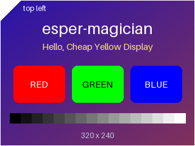

# Firmware: picture and GIF player for the ESP32-2432S028R

This is an [ESP-IDF](https://docs.espressif.com/projects/esp-idf/en/stable/esp32/get-started/index.html)
project for the ESP32-2432S028R ("Cheap Yellow Display", 2.8 in, 320×240).
It shows one picture or loops one GIF on the screen.

Out of the box it shows a test card. The test card has red, green and blue
blocks and a marked top-left corner, so you can check that colours and
orientation are right before you load your own picture.



It uses Espressif's own `esp_lcd` driver with the
[`esp_lcd_ili9341`](https://components.espressif.com/components/espressif/esp_lcd_ili9341)
component. ESP-IDF downloads that component on the first build.

## What you need

- An ESP32-2432S028R and a USB **data** cable (some cables only charge).
- ESP-IDF **v5.2 or newer** (built and tested with v5.5.1). Follow
  [Espressif's install guide](https://docs.espressif.com/projects/esp-idf/en/stable/esp32/get-started/index.html#installation)
  for your computer.
- Python with Pillow, only if you want to use your own picture:
  `python -m pip install pillow`.

If your computer does not see the board, install the USB serial driver for the
chip on it. Most of these boards use a CH340; some use a CP2102.

## Build and flash

Open the ESP-IDF terminal (Windows) or run `. $HOME/esp/esp-idf/export.sh`
(macOS/Linux) first, then:

```bash
cd firmware
idf.py set-target esp32      # only the first time
idf.py build
idf.py -p PORT flash monitor
```

`PORT` is the board's serial port, such as `COM5` on Windows,
`/dev/cu.usbserial-110` on macOS, or `/dev/ttyUSB0` on Linux.
Press `Ctrl+]` to leave the monitor.

If flashing does not start, hold the **BOOT** button on the board, tap **RST**,
release **BOOT**, and run the flash command again.

### Flashing the built files with another tool

`idf.py build` writes these files to `build/`:

| File | Flash address |
| --- | --- |
| `bootloader/bootloader.bin` | `0x1000` |
| `partition_table/partition-table.bin` | `0x8000` |
| `cyd_picture.bin` | `0x10000` |

`idf.py merge-bin -o cyd_picture-merged.bin` joins them into one file, which
goes at address `0x0`. That single file is the easiest one to use with a web
flasher.

```bash
python -m esptool --chip esp32 -b 460800 write_flash 0x0 build/cyd_picture-merged.bin
```

## Show your own picture or GIF

```bash
cd firmware
python tools/img2cyd.py path/to/photo.jpg       # a still picture
python tools/img2cyd.py path/to/animation.gif   # a looping animation
idf.py build
idf.py -p PORT flash
```

The tool resizes to 320×240 and writes `main/images/picture.bin`, which is
built into the firmware. Options:

- `--fit contain` shows the whole picture with black borders. The default,
  `--fit cover`, fills the screen and crops the edges.
- `--max-frames N` keeps N frames of a long GIF. About 24 full-screen frames
  fit in the board's flash; the tool tells you if a GIF is too big.
- `--delay MS` sets the same time for every frame.

A full-screen frame takes about 35 ms to send to the screen, so a GIF runs at
most about 25 frames per second. Faster GIFs play slower than on a computer.

To go back to the test card: `python tools/img2cyd.py main/images/test-card.png`.

## If the picture looks wrong

Run `idf.py menuconfig`, open **Cheap Yellow Display**, change one setting,
then build and flash again.

| What you see | Setting |
| --- | --- |
| Red and blue are swapped | turn off **Screen uses BGR colour order** |
| Colours look like a photo negative | turn on **Invert colours** |
| Text is backwards (mirrored) | flip **Mirror the picture left to right** |
| Picture is upside down | flip both mirror settings |
| Noise, stripes or a garbled picture | lower **SPI clock** to 20 MHz |
| Screen stays dark | check the board model; see the pins below |
| Solid red screen | `picture.bin` is broken; run `tools/img2cyd.py` again |

## Pins

From `main/board_cyd.h`. These match the common pinout for this board.

| Signal | GPIO |
| --- | --- |
| SCLK | 14 |
| MOSI | 13 |
| MISO | 12 |
| CS | 15 |
| DC | 2 |
| Backlight | 21 |
| Reset | not used (tied to EN) |

## Not checked on a real board yet

This builds cleanly with ESP-IDF v5.5.1, but it has not been run on hardware.
These parts are best guesses:

- **Colour order (BGR) and mirroring.** The defaults match what most
  ESP32-2432S028R boards need in landscape. If yours differs, use the table
  above.
- **The screen chip.** This assumes an ILI9341, which the original board uses.
  Some newer boards with two USB ports use an ST7789 instead. Those need a
  driver change, not just a setting.
- **40 MHz SPI clock.** Usually fine for this screen; 20 MHz is the safe
  fallback.

## Files

```
firmware/
├── CMakeLists.txt         ESP-IDF project
├── sdkconfig.defaults     4 MB flash, custom partition table
├── partitions.csv         one large app partition, so GIFs fit
├── main/
│   ├── main.c             sets up the screen and plays the picture
│   ├── picture_player.c   reads picture.bin and streams it to the screen
│   ├── board_cyd.h        pins for this board
│   ├── Kconfig.projbuild  the "Cheap Yellow Display" menuconfig settings
│   ├── idf_component.yml  pulls in esp_lcd_ili9341
│   └── images/
│       ├── picture.bin    what gets shown (made by img2cyd.py)
│       └── test-card.png  the default picture
└── tools/
    ├── img2cyd.py         picture/GIF → picture.bin
    └── make_test_card.py  redraws test-card.png
```
