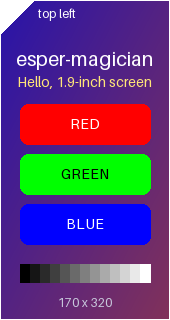

# Firmware: picture and GIF player for the ESPER screens

This is an [ESP-IDF](https://docs.espressif.com/projects/esp-idf/en/stable/esp32/get-started/index.html)
project that shows one picture or loops one GIF. It runs on either screen:

| Screen | Board | Size |
| --- | --- | --- |
| 2.8-inch | ESP32-2432S028R ("Cheap Yellow Display"), ILI9341 | 320×240 landscape |
| 1.9-inch | ST7789 module wired to an ESP32 DevKit 38-pin (WROOM-32E) | 170×320 portrait |

Both boards are a classic ESP32 with 4 MB of flash. You pick which one to
build for in menuconfig (see [Build and flash](#build-and-flash)).

Out of the box it shows a test card. The test card has red, green and blue
blocks and a marked top-left corner, so you can check that colours and
orientation are right before you load your own picture.




It uses Espressif's own `esp_lcd` driver: the
[`esp_lcd_ili9341`](https://components.espressif.com/components/espressif/esp_lcd_ili9341)
component for the 2.8-inch screen (ESP-IDF downloads it on the first build),
and the ST7789 driver built into ESP-IDF for the 1.9-inch one.

## What you need

- One of the boards above and a USB **data** cable (some cables only charge).
- ESP-IDF **v5.2 or newer** (this version builds with v6.1). Follow
  [Espressif's install guide](https://docs.espressif.com/projects/esp-idf/en/stable/esp32/get-started/index.html#installation)
  for your computer.
- Python with Pillow, only if you want to use your own picture:
  `python -m pip install pillow`.

If your computer does not see the board, install the USB serial driver for the
chip on it. The 2.8-inch boards mostly use a CH340, some a CP2102. The ESP32
DevKit for the 1.9-inch screen uses a CP2102.

## Wiring the 1.9-inch screen

The 2.8-inch board has its screen built in, so skip this for that one.

Wire with the USB cable unplugged. The screen runs on **3.3 V only**: never
connect its VCC to 5V.

| Screen pin | ESP32 DevKit pin |
| --- | --- |
| SCL | GPIO 18 |
| SDA | GPIO 23 |
| RES | GPIO 4 |
| DC | GPIO 21 |
| CS | GPIO 22 |
| BLK | GPIO 32 |
| VCC | 3V3 |
| GND | GND |

Optional: a push button between **GPIO 33** and **GND**. No resistor is needed,
because the firmware turns on the pin's built-in pull-up. Each press switches
between your picture and a colour test card.

Go by the labels printed on your screen. If its pins are in a different order,
move the wires to match the labels, not the positions.

These pins live in `main/board_devkit_st7789.h`. If you wire a pin differently,
change that line and build again.

## Build and flash

Open the ESP-IDF terminal (Windows) or run `. $HOME/esp/esp-idf/export.sh`
(macOS/Linux) first, then:

```bash
cd firmware
idf.py set-target esp32      # only the first time
idf.py menuconfig            # only for the 1.9-inch screen, see below
idf.py build
idf.py -p PORT flash monitor
```

The 2.8-inch screen is the default. For the 1.9-inch screen, in menuconfig open
**ESPER screen → Which screen is this for?**, choose **1.9-inch ST7789 (170x320)
on an ESP32 DevKit**, then press `S` to save and `Q` to quit.

To build for the 1.9-inch screen without menuconfig, and keep its build apart
from the 2.8-inch one:

```bash
idf.py -B build-1.9 -D SDKCONFIG=build-1.9/sdkconfig \
  -D SDKCONFIG_DEFAULTS="sdkconfig.defaults;sdkconfig.defaults.1.9" build
idf.py -B build-1.9 -D SDKCONFIG=build-1.9/sdkconfig -p PORT flash monitor
```

`PORT` is the board's serial port, such as `COM5` on Windows,
`/dev/cu.usbserial-110` on macOS, or `/dev/ttyUSB0` on Linux.
Press `Ctrl+]` to leave the monitor.

If flashing does not start, hold the **BOOT** button on the board, tap
**RST** (called **EN** on the DevKit), release **BOOT**, and run the flash
command again.

### Flashing the built files with another tool

`idf.py build` writes these files to `build/`:

| File | Flash address |
| --- | --- |
| `bootloader/bootloader.bin` | `0x1000` |
| `partition_table/partition-table.bin` | `0x8000` |
| `cyd_picture.bin` | `0x10000` |

`idf.py merge-bin -o cyd_picture-merged.bin` joins them into one file, which
goes at address `0x0`. That single file is the easiest one to use with a web
flasher.

```bash
python -m esptool --chip esp32 -b 460800 write_flash 0x0 build/cyd_picture-merged.bin
```

## Show your own picture or GIF

```bash
cd firmware
python tools/img2cyd.py path/to/photo.jpg                      # 2.8-inch screen
python tools/img2cyd.py path/to/animation.gif --screen 1.9     # 1.9-inch screen
idf.py build
idf.py -p PORT flash
```

The tool resizes to the screen's size (320×240, or 170×320 with
`--screen 1.9`) and writes `main/images/<screen>/picture.bin`. The build picks
the file for the screen chosen in menuconfig. Options:

- `--fit contain` shows the whole picture with black borders. The default,
  `--fit cover`, fills the screen and crops the edges.
- `--max-frames N` keeps N frames of a long GIF. About 24 full-screen frames
  fit on the 2.8-inch screen, about 34 on the 1.9-inch one; the tool tells you
  if a GIF is too big.
- `--delay MS` sets the same time for every frame.

A full-screen frame on the 2.8-inch screen takes about 35 ms to send, so a GIF
runs at most about 25 frames per second. Faster GIFs play slower than on a
computer. The 1.9-inch screen has fewer pixels, so it's a little faster.

To go back to the test card:
`python tools/img2cyd.py main/images/2.8/test-card.png` (or
`main/images/1.9/test-card.png --screen 1.9`).

## If the picture looks wrong

Run `idf.py menuconfig`, open **ESPER screen**, change one setting, then build
and flash again.

On the 1.9-inch screen, press the button on GPIO 33 to see the colour test card.
It has seven bars (white, yellow, cyan, green, magenta, red, blue), a grey ramp
from black to white, a white triangle in the top-left corner, and a thin white
frame round the edge.

| What you see | Setting |
| --- | --- |
| Red and blue are swapped | flip **Screen uses BGR colour order** |
| Colours look like a photo negative (white bar looks black) | flip **Invert colours** |
| Text is backwards, or the corner triangle is top right | flip **Mirror the picture left to right** |
| Picture is upside down | flip both mirror settings |
| Noise, stripes or a garbled picture | lower **SPI clock** to 20 MHz |
| 1.9-inch: an edge of the white frame is missing, or a stripe of noise down one side | the 35-column offset in `board_devkit_st7789.h` is wrong for your screen |
| Screen stays dark | check the board choice in menuconfig, and the wiring |
| Solid red screen | `picture.bin` is broken or for the other screen; run `tools/img2cyd.py` again with the right `--screen` |

## Pins

### 2.8-inch ESP32-2432S028R

From `main/board_cyd.h`. These match the common pinout for this board.

| Signal | GPIO |
| --- | --- |
| SCLK | 14 |
| MOSI | 13 |
| MISO | 12 |
| CS | 15 |
| DC | 2 |
| Backlight | 21 |
| Reset | not used (tied to EN) |

### 1.9-inch screen on an ESP32 DevKit

From `main/board_devkit_st7789.h`. See [Wiring the 1.9-inch screen](#wiring-the-19-inch-screen).

| Signal | GPIO |
| --- | --- |
| SCLK (screen SCL) | 18 |
| MOSI (screen SDA) | 23 |
| CS | 22 |
| DC | 21 |
| Reset (screen RES) | 4 |
| Backlight (screen BLK) | 32 |
| Picture button | 33 |

On both boards the **BOOT** button (GPIO 0) is left alone, so it stays free for
the hold-to-reset feature (ASH-32).

## Not checked on a real board yet

This builds cleanly for both screens with ESP-IDF v6.1 (the 2.8-inch-only
version before it was built with v5.5.1), but it has not been run on hardware. These parts are best guesses:

- **Colour order (BGR) and mirroring.** The 2.8-inch defaults match what most
  ESP32-2432S028R boards need in landscape. The 1.9-inch defaults are RGB with
  colours inverted, which most 1.9-inch IPS ST7789 screens need. If yours
  differs, use the table above.
- **The 2.8-inch screen chip.** This assumes an ILI9341, which the original
  board uses. Some newer boards with two USB ports use an ST7789 instead.
  Those need a driver change, not just a setting.
- **The 1.9-inch offset.** 35 columns is what 170×320 ST7789 screens
  normally use.
- **40 MHz SPI clock.** Usually fine for both screens; 20 MHz is the safe
  fallback.

## Files

```
firmware/
├── CMakeLists.txt             ESP-IDF project
├── sdkconfig.defaults         4 MB flash, custom partition table
├── sdkconfig.defaults.1.9     picks the 1.9-inch screen (optional, see above)
├── partitions.csv             one large app partition, so GIFs fit
├── main/
│   ├── main.c                 sets up the screen, plays the picture, reads the button
│   ├── picture_player.c       reads picture.bin and streams it to the screen
│   ├── test_card.c            draws the colour test card in code
│   ├── board.h                picks the pin file for the chosen screen
│   ├── board_cyd.h            pins for the 2.8-inch board
│   ├── board_devkit_st7789.h  pins for the 1.9-inch screen on the DevKit
│   ├── Kconfig.projbuild      the "ESPER screen" menuconfig settings
│   ├── idf_component.yml      pulls in esp_lcd_ili9341
│   └── images/
│       ├── 2.8/               picture.bin (what gets shown) and test-card.png
│       └── 1.9/               the same, sized for the 1.9-inch screen
└── tools/
    ├── img2cyd.py             picture/GIF → picture.bin
    └── make_test_card.py      redraws test-card.png
```
